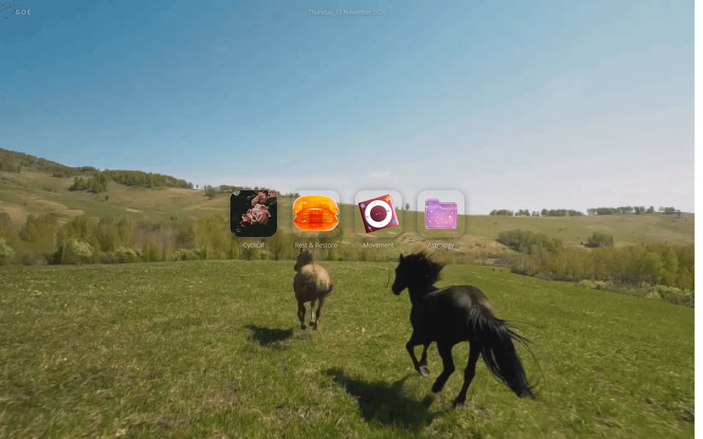
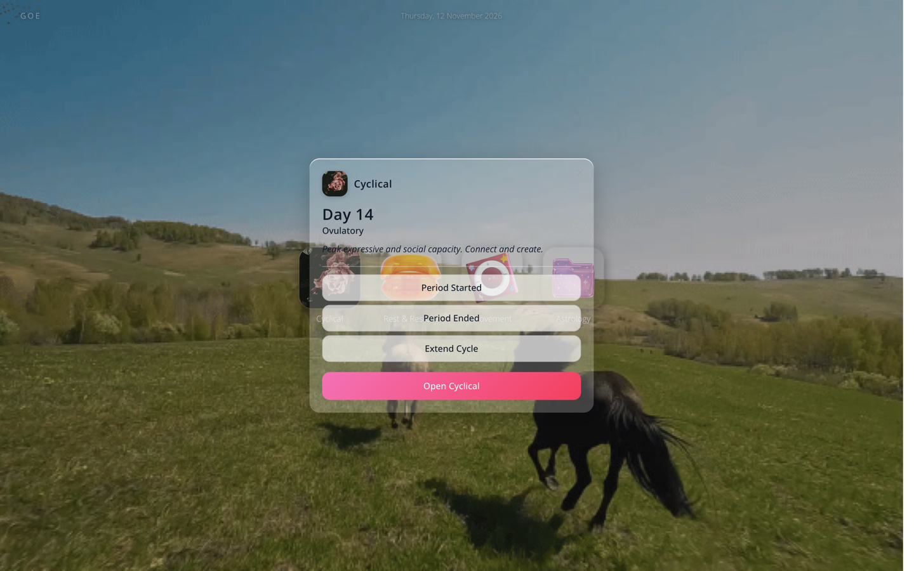

# Inside Your GOE

This is a visual map of the source folder that becomes your own GOE.

The app is the part you see. The rest of the folder gives the app somewhere to keep records, a way to make readings, and tools for the connections you choose.

## Home is the front door



_Home showing the four-card GOE. No personal record or contributor data appears in this image._

Home opens into four cards: Cyclical, Rest & Restore, Movement and Astrology. Their images and visible layouts are under `client/`. Their records and private connections are handled behind the screen under `server/`.

| What you open      | What you can do there                                           | Main source area                                   |
| ------------------ | --------------------------------------------------------------- | -------------------------------------------------- |
| **Home**           | See the four cards and open a card or Home chat                 | `client/src/components/OrbHomeScreen.jsx`          |
| **Cyclical**       | See your cycle, moon phase and connected moon-centre pattern    | `client/src/components/CyclicalIntelligenceCard/`  |
| **Rest & Restore** | Enter Rest and Rising check-ins and read them with your sleep   | `client/src/components/RestIntelligenceCard/`      |
| **Movement**       | Take an HRV reading, read movement readiness and keep practices | `client/src/components/MovementIntelligenceCard/`  |
| **Astrology**      | Read your chart, sky, transits, Gene Keys and Human Design      | `client/src/components/AstrologyIntelligenceCard/` |

## The six parts of the folder

### `client/` — what you see and use

The client is the visible app: Home, the four cards, their pop ups, chat panels, buttons, calendars and images.

The client also marks a qualified return when GOE loads visibly or becomes visible after at least 30 minutes outside visible use. It records no screen path, click, search, text, scroll or device detail.

```text
client/
├── public/       Images, video and favicon shown by the app
└── src/
    ├── components/   Home, cards, chat and seven reusable controls
    ├── hooks/        Ways the visible app asks for saved information
    ├── lib/          Shared browser calculations and connections
    └── pages/        The swipeable desktop and mobile frame
```

Changing something here can change what a person sees or how they interact with it. Step 10 of the deployment guide uses the existing image paths without changing the card design.

### `server/` — what works behind the screen

The server receives the app’s requests, keeps every request with the one local owner, reads and saves records, prepares model writing and runs the connections the owner has configured.

```text
server/
├── routes/       The owner-only paths used by Home and the four cards
├── prompts/      The writing instructions used by chat and weekly readings
├── health/       The Apple Health translation
├── storage/      The owner’s chosen local-disk file storage
└── lib/          Focused calculations and refresh helpers
```

The database, private settings and stored personal files are not inside this source folder. The server reaches them through the places chosen during setup. Exact Return Pattern timestamps stay in that owner database.

### `shared/` — what both sides agree a record means

The shared files define the shape and meaning of records used by the visible app and the server. They include the database tables, cycle and moon calculations, contribution boundary, Movement signal and chart-import shapes.

When the meaning of a contributed field changes, this layer changes together with its instrument, mapping, consent and receiving checks. It is not a copy-only writing edit.

### `setup/` — the connections you choose

The setup folder contains three bounded connections:

- `agent-feed/` writes available current context into the marked parts of an owner-chosen agent file.
- `chart-prompts/` prepares and checks Gene Keys and Human Design chart readings before import.
- `moon-centres.md` explains how an owner connects a Kundalini moon-centre pattern they already know.

Each connection starts from an owner’s choice. The agent feed and moon centres begin off. Chart and provider values are absent until the owner supplies them.

### `scripts/` — setup, import and proof tools

Scripts are named actions run from Terminal through `npm run …`.

- Setup scripts create the local owner or apply an optional CASTLE Lab connection.
- Import scripts bring Apple Health or prepared chart records into the owner’s instance.
- Generation scripts prepare chart or weekly writing through the owner’s configured provider.
- Test scripts check one named part using synthetic or isolated records.

The 19-step guide names the scripts needed during setup. The other tests travel with the source so a maintainer can check the part they change.

### `docs/` — the map you can return to

This guide and the file index live here after approval. The technical references explain the card-build pattern, HRV source adapters and the Movement record split.

## How one card fits together

A card first opens as a pop up on Home:



_The Cyclical pop up using a synthetic cycle record._

Movement shows the full source shape most clearly:

| Layer                 | Movement example                                  | What it does                                                   |
| --------------------- | ------------------------------------------------- | -------------------------------------------------------------- |
| Image                 | `client/public/images/Movement.webp`              | Gives Home and the pop up their existing image                 |
| Visible card          | `client/src/components/MovementIntelligenceCard/` | Shows the reading, practices and archive                       |
| Browser connection    | `client/src/hooks/useMovementContext.ts`          | Requests and refreshes Movement information                    |
| Owner-only route      | `server/routes/movement.ts`                       | Accepts and returns Movement records                           |
| Record store          | `server/storage.ts` and `shared/schema.ts`        | Saves the owner’s records in their database                    |
| Meaning               | `shared/movementSignal.ts`                        | Keeps the signal and practice fields consistent                |
| Optional contribution | `server/contributionProjection.ts`                | Selects only approved fields after current consent is checked  |
| Agent context         | `server/cardContext.ts` and `setup/agent-feed/`   | Makes available Movement context readable to a connected agent |

The other three cards follow the same broad path, with their own visible card folder and owner-only routes.

## Where a saved record travels

```text
You enter or import a record
              ↓
The visible card sends it through an owner-only route
              ↓
The server saves it in your database
              ↓
The card reads it back into your GOE
              ↓
Your chosen optional connections can read only their defined part
```

The optional connections are separate:

- Chat buttons stay visible while chat is off. They open an explanation until the owner turns on both chat switches and chooses a working connection.
- The agent feed is off until the owner chooses a local agent file and enables refresh.
- CASTLE Lab contribution is optional. You choose which areas to share, and every send checks that those choices are still active.

## The top-level files

The files beside the six folders are the package boundary:

| File                                                                         | Plain-language purpose                                                            |
| ---------------------------------------------------------------------------- | --------------------------------------------------------------------------------- |
| `.env.example`                                                               | Setup map with safe defaults and blank private settings for the owner to complete |
| `.github/workflows/quality.yml`                                              | Runs the quality checks when the source changes                                   |
| `.prettierrc.json` and `eslint.config.js`                                    | Apply the source formatting and code checks                                       |
| `package.json`                                                               | Names the commands and supporting software GOE uses                               |
| `package-lock.json`                                                          | Locks those software versions exactly                                             |
| `THIRD_PARTY_NOTICES.md`                                                     | Lists third-party software and licences                                           |
| `LICENSE`                                                                    | The AGPL licence for GOE's source                                                 |
| `COMMERCIAL.md`                                                              | The separate commercial-licensing route                                           |
| `tsconfig.json`, `vite.config.ts`, `tailwind.config.ts`, `postcss.config.js` | Build settings used by the app                                                    |

## What is yours to recognise and what needs a checked build

| Change                               | Where to begin                                             | Check before using it                                                                                              |
| ------------------------------------ | ---------------------------------------------------------- | ------------------------------------------------------------------------------------------------------------------ |
| Replace the supplied images          | Deployment Guide Step 10                                   | Open Home and each changed pop up on desktop and phone                                                             |
| Refine GOE's vocabulary              | Deployment Guide Step 14                                   | Run lint, formatting, the code check and build, then check a fresh conversation                                    |
| Refine writing instructions          | Deployment Guide Step 15                                   | Preserve the data placeholders, run lint, formatting, the code check and build, then read a newly generated result |
| Add a new data source                | `docs/hrv-source-adapters.md` or the Apple Health importer | Use synthetic records first; confirm the source, record meaning and owner boundary                                 |
| Change a record or contributed field | `shared/`, the matching route and contribution contract    | Review the meaning, consent, mapping, receiver and affected tests together before release                          |

## The detailed lookup

[File Index](FILE_INDEX.md) names the files in each area and what someone opens them for.
